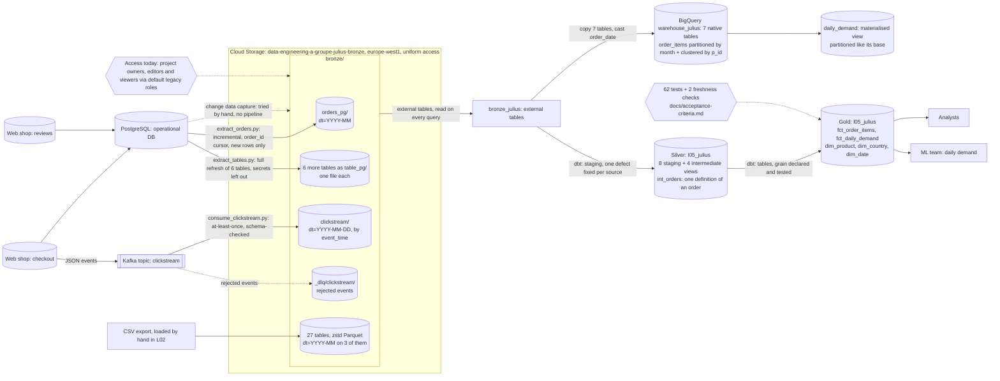

# Architecture

> Update this page at the end of every lesson. It is the diagram you present at
> the oral defence.

## Context

Albert's Marketplace needs its order, stock and review data turned into
trustworthy reports and, eventually, a daily demand forecast, without
burdening the operational database that serves live checkout traffic.
Analysts need one agreed figure per question instead of a report per tool,
and the ML team needs a daily, historised table it does not have today.
Daily freshness is enough everywhere; nothing in the current data flows needs
real-time delivery. Payment and password data must never leave the source
system unredacted, which constrains every layer built on top of it.

## Architecture as built

Silver and gold now exist (lesson 5): a dbt project reads bronze through
external tables and builds the star schema in `l05_julius`. Revenue now has one
definition, which is a rule that under-removes duplicate orders, so it is a better
answer and not yet the true one ([`acceptance-criteria.md`](acceptance-criteria.md)).

Bronze is queryable through BigQuery (lesson 4): seven tables are copied into
native, tuned tables and one materialised view serves the ML team's daily
demand. It reads straight off bronze, with no definition of an order between
them, so "revenue" has two answers (13.07 M and 6.52 M EUR over twelve months;
see [`warehouse-tuning.md`](warehouse-tuning.md)). Every query has a byte cap.

Three scripts now write into bronze: two extractors (from PostgreSQL) and the
consumer (from Kafka). The third, change data capture, was run by hand in
exercise 1 and has no pipeline, so its arrow is dashed. There is no Airbyte
connector. Neither script is scheduled yet; I start them by hand until
lesson 7. Access is still the project default
([`infra/iam.md`](../infra/iam.md)). Choices are argued in
[ADR-0002](adr/0002-bronze-layout.md) and
[ADR-0003](adr/0003-ingestion-modes.md); failure behaviour is in
[`ingestion-failure-modes.md`](ingestion-failure-modes.md).

## Layers

| Layer | What lands here | What it guarantees | Who reads it |
|---|---|---|---|
| Bronze | 27 tables from the operational database as zstd Parquet in `europe-west1`; `orders`, `order_items`, `payment` partitioned by month | Nothing that arrived is lost or altered; full raw history is kept, including rows later found to be duplicates or errors. Holds secrets (passwords, card data), flagged in the [data dictionary](data-dictionary.md) | Intended: silver job only, no direct analyst or ML access. Today: the whole project (see `infra/iam.md`) |
| Silver | Built (L05): staging views fixing one named defect each, and intermediate views holding the joins that decide something. Twin orders collapsed by one rule; no contact or payment data selected | One agreed version of each fact, with the limit that the twin rule under-removes. **No history of changes**: there are no snapshots | Pipeline jobs building gold tables |
| Gold | Tables that answer a named question: reporting tables for analysts, the daily units-sold-by-product-by-country table for the ML team | Each table answers one stated question and is safe to query directly | Analysts, ML team |

## Decisions

| ADR | Decision | Status |
|---|---|---|
| [0001](adr/0001-target-architecture.md) | Two-tier architecture: object storage for bronze, a warehouse for silver and gold | Accepted |
| [0002](adr/0002-bronze-layout.md) | Bronze as zstd Parquet, partitioned by month on the three transactional tables | Accepted |
| [0003](adr/0003-ingestion-modes.md) | Streaming consumer for clickstream, incremental cursor for orders, updates and deletes unhandled | Accepted |
| [0004](adr/0004-warehouse-pricing.md) | BigQuery on demand with a per-query byte cap | Accepted |
| [0005](adr/0005-materialisations.md) | Views for staging and intermediate, tables for marts | Accepted |

## Change log

| Lesson | What changed |
|---|---|
| L01 | First version |
| L02 | Bronze built: bucket, layout, lifecycle and real access shown; silver and gold still planned |
| L03 | Two ingestion paths into bronze (extractor, consumer) with a dead letter queue; change data capture and Airbyte not built |
| L04 | Warehouse added: bronze queryable, 7 native tables, month partitions, a materialised view, a byte cap. Slow-query runbook in `docs/runbooks/` |
| L05 | Silver and gold built with dbt in `transform/`: sources, staging, one definition of an order, a star schema with declared and tested grains, 62 tests and freshness. Lineage in `docs/lineage.md` |
