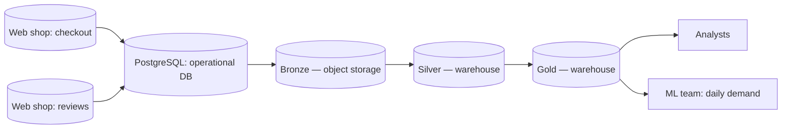

# Architecture

> Update this page at the end of every lesson. It is the diagram you present at
> the oral defence.

## Context

Albert's Marketplace needs its order, stock and review data turned into
trustworthy reports and, eventually, a daily demand forecast, without
burdening the operational database that serves live checkout traffic.
Analysts need one agreed figure per question instead of a report per tool,
and the ML team needs a daily, historised table it does not have today.
Daily freshness is enough everywhere; nothing in the current data flows needs
real-time delivery. Payment and password data must never leave the source
system unredacted, which constrains every layer built on top of it.

## Target architecture

Technology is not yet named for bronze and the warehouse; see
[ADR-0001](adr/0001-target-architecture.md), which chose a two-tier
architecture (object storage for bronze, a warehouse for silver and gold)
over a warehouse-only, lake-only or lakehouse design.

## Layers

| Layer | What lands here | What it guarantees | Who reads it |
|---|---|---|---|
| Bronze | Raw orders, lines, payments, stock and reviews, exactly as extracted from the operational database | Nothing that arrived is lost or altered; full raw history is kept, including rows later found to be duplicates or errors | Pipeline jobs only — no direct analyst or ML access |
| Silver | Deduplicated orders, customers and products, with payment and password data stripped | One agreed version of each fact; no secrets; history of changes over time, not just the current state | Pipeline jobs building gold tables |
| Gold | Tables that answer a named question: reporting tables for analysts, the daily units-sold-by-product-by-country table for the ML team | Each table answers one stated question and is safe to query directly | Analysts, ML team |

## Decisions

| ADR | Decision | Status |
|---|---|---|
| [0001](adr/0001-target-architecture.md) | Two-tier architecture: object storage for bronze, a warehouse for silver and gold | Accepted |

## Change log

| Lesson | What changed |
|---|---|
| L01 | First version |
