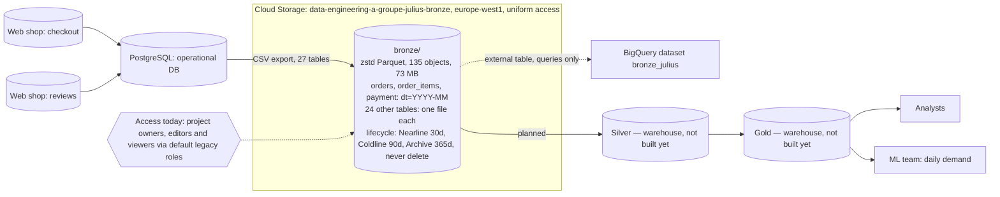

# Architecture

> Update this page at the end of every lesson. It is the diagram you present at
> the oral defence.

## Context

Albert's Marketplace needs its order, stock and review data turned into
trustworthy reports and, eventually, a daily demand forecast, without
burdening the operational database that serves live checkout traffic.
Analysts need one agreed figure per question instead of a report per tool,
and the ML team needs a daily, historised table it does not have today.
Daily freshness is enough everywhere; nothing in the current data flows needs
real-time delivery. Payment and password data must never leave the source
system unredacted, which constrains every layer built on top of it.

## Architecture as built

Bronze is built: one regional bucket holding the whole export. Access is the
project default, wider than the design: every project editor can write and
every viewer can read, secrets included. Dedicated service accounts could not
be created with my permissions (see [`infra/iam.md`](../infra/iam.md)). Silver
and gold are still the plan from [ADR-0001](adr/0001-target-architecture.md).
Layout choices are argued in [ADR-0002](adr/0002-bronze-layout.md); the
lifecycle rule is in [`infra/lifecycle.json`](../infra/lifecycle.json).

## Layers

| Layer | What lands here | What it guarantees | Who reads it |
|---|---|---|---|
| Bronze | 27 tables from the operational database as zstd Parquet in `europe-west1`; `orders`, `order_items`, `payment` partitioned by month | Nothing that arrived is lost or altered; full raw history is kept, including rows later found to be duplicates or errors. Holds secrets (passwords, card data), flagged in the [data dictionary](data-dictionary.md) | Intended: silver job only, no direct analyst or ML access. Today: the whole project (see `infra/iam.md`) |
| Silver | Deduplicated orders, customers and products, with payment and password data stripped | One agreed version of each fact; no secrets; history of changes over time, not just the current state | Pipeline jobs building gold tables |
| Gold | Tables that answer a named question: reporting tables for analysts, the daily units-sold-by-product-by-country table for the ML team | Each table answers one stated question and is safe to query directly | Analysts, ML team |

## Decisions

| ADR | Decision | Status |
|---|---|---|
| [0001](adr/0001-target-architecture.md) | Two-tier architecture: object storage for bronze, a warehouse for silver and gold | Accepted |
| [0002](adr/0002-bronze-layout.md) | Bronze as zstd Parquet, partitioned by month on the three transactional tables | Accepted |

## Change log

| Lesson | What changed |
|---|---|
| L01 | First version |
| L02 | Bronze built: bucket, layout, lifecycle and real access shown; silver and gold still planned |
