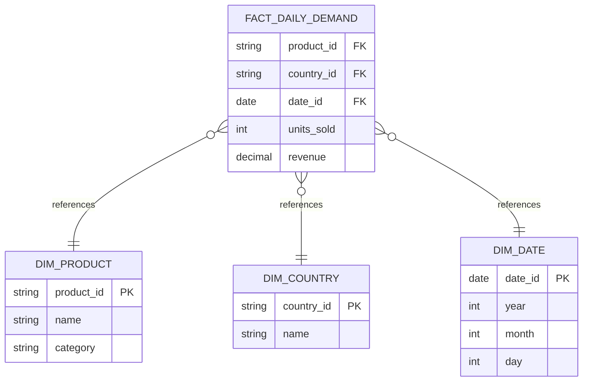

# Star: daily demand

## Business process

Selling a product to a customer: every line of a completed order contributes
to how much of that product moved, in which country, on which day.

## Grain

One row per product, per country, per day.

## Dimensions

- **Product** — with its category. The seller cannot be a dimension at this
  grain: an order line does not record which seller sold the product.
- **Country** — the shipping country of the order.
- **Date** — the calendar day the order was placed.

## Facts

| Fact | Summable? |
|---|---|
| Units sold | Yes — sums across product, country and date |
| Revenue | Yes — sums across product, country and date |

## Sketch

## Why this grain, from the very first ingestion

This sketch is what the ML team asked for (flow 5 in
[`data-flows.md`](../data-flows.md)), and it says which columns bronze must
carry even though the warehouse model isn't built until L05:

- Every order line needs its **product**, **shipping country** and **order
  date** to survive ingestion untouched — this fact table cannot be rebuilt
  later from an aggregate that dropped them.
- **Seller** is deliberately left out: it does not exist at the order-line
  grain, and adding it later would mean re-extracting raw data, not just
  re-modelling what's already in bronze.
